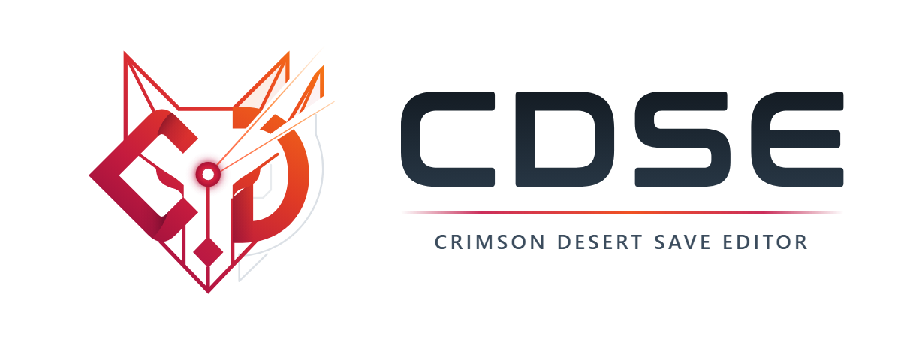

<p align="center">
  <picture>
    <source media="(prefers-color-scheme: dark)" srcset=".github/assets/cdse-horizontal-dark-1200w.png">
    <source media="(prefers-color-scheme: light)" srcset=".github/assets/cdse-horizontal-light-1200w.png">
    
  </picture>
</p>

<h3 align="center">Edit your save. Leave no trace.</h3>
<p align="center">Native-faithful save editing for <i>Crimson Desert</i> — every change written the way the game itself would.</p>

<p align="center">
  <a href="#supported-versions">Versions</a> · <a href="#install"><b>Install</b></a> ·
  <a href="#features">Features</a> · <a href="#safety-and-save-doctor">Save Doctor</a> ·
  <a href="#updates">Updates</a> · <a href="#support">Support</a>
</p>

<p align="center">
  <a href="https://github.com/geonuz/save-ultimate-crimson-desert/releases/latest"></a>
  <a href="https://github.com/geonuz/save-ultimate-crimson-desert/releases"></a>
  <a href="https://discord.gg/heESrXvMqj"></a>
  
  <a href="LICENSE"></a>
</p>

<p align="center"><sub>UI Languages: English · 한국어 · 日本語 · Русский · Français · Deutsch · Español · Português (BR)</sub></p>

**Open source, structure-faithful, and built for safety.** CDSE (called SaveUltimate up to 1.9.0) is an unofficial Windows x64 save editor for *Crimson Desert*, rebuilt in C#/.NET from the original Python/Qt editor. Developed and maintained by geonuz with assistance from AI agents.

<!-- Optional hero screenshot. Uncomment when a screenshot is ready.
<p align="center">
  
  <br><sub>Clean, localized editing backed by your own game data.</sub>
</p>
-->

## Supported Versions

| Game version | Status |
| --- | --- |
| **2.06.00** (with or without DLC 1) | Verified with this release |
| **2.05.x** and **2.04.x** | Opens, edits, and tested with this release |
| **Earlier 2.x** | Opens and edits, no longer actively tested |
| **1.x** | Not supported — opening reports `[CDSE-301]` |

> [!NOTE]
> - **Game Data Sync** requires an installed **2.06.00** game folder (that update changed the layout of every game data table).
> - **DLC Detection**: Without `dlc/dlc_01` in the game folder, the header says so, and DLC items, knowledge, fish, skills, challenges, and map places are hidden and cannot be edited.
> - **Settings** shows the editor version and the game version it was verified with.
> - Game names, icons, and descriptions are read directly from your local installation's localization data.

## Install

**[Download CDSE for Windows x64 →](https://github.com/geonuz/save-ultimate-crimson-desert/releases/latest)**

No separate .NET runtime is required.

1. Download the Windows ZIP from [Releases](https://github.com/geonuz/save-ultimate-crimson-desert/releases/latest) and extract it to a writable folder.
2. Run **`CDSE.exe`** (keep all shipped `.dll` files and `resources/` beside the executable; it does not run without them).
3. Open **Settings**, select your *Crimson Desert* installation folder, and run **Sync game data**.
4. Click **Open** to load a save, make your edits, and click **Save**.

<details>
<summary><b>Folder layout & local game data sync</b></summary>

Sync reads your installed game **without modifying it**, extracting item data, localized names, and item/fish/skill images locally (no game images are bundled or downloaded). Placeholder icons appear until the first sync.

```text
CDSE.exe
*.dll               Native libraries for images and the interface (shipped)
resources/          Baseline catalogs, translations, and artwork (shipped)
licenses/           Third-party notices (shipped)
editor_config.json  Editor preferences
error.log           Details of reported errors
backups/            Copies of your save backups
game_data/          Synchronized game data and images
.update/            Files of an update in progress, removed at the next start (GitHub package only)
```

</details>

## Features

Every edit is designed to match *Crimson Desert*'s native save structure and record patterns, validated against the full file format before and after writing.

| Category | Highlights |
| --- | --- |
| **Items** | Inventory quantities & copies, vendor repurchase swap, collection box, item database with item add |
| **Character** | Equipment enchantments, Abyss Gear sockets with effects, Watch-and-Learn skills, dyes with `.sudye` file & code sharing |
| **Adventure Journal** | Knowledge entries & levels, challenge completion, fishing records |
| **Map** | Nodes & places, memory fragments, full map reveal, Abyss points, crafting stations, chests & ore deposits |
| **NPC** | Mercenaries & Grey-0 recruits, trust & DLC bonds |
| **Pets & Mounts** | Pets, horses, special mounts, wagons & ships — add, remove, rename, reorder, change gear |
| **Life** | DLC business renown, 15 housing plots, `.suhouse` house export & import, 180° house rotation |
| **Other** | Forward game clock adjustment, Save Doctor, edit history, eight themes + custom colors |

<details>
<summary><b>Items</b> — Inventory, Item Swap, Collection, Database</summary>

- **Inventory**: Set the quantity of one or several items (`1`–`999,999,999`) or delete them. An item that does not stack, such as equipment, becomes that many separate copies as long as the bag has room; for one that stacks, the editor shows how many slots the game uses. Items carried by mercenaries are skipped. Collection documents locked in the quest bag as important items can be released into the inventory, as reading them in the game would.
- **Item Swap (Repurchase)**: Replace an item in a vendor's buy-back list with another item, then buy it back in the game.
- **Collection**: Fill the collection box by item or by class (documents, recipes, books, treasure maps, keys and more) and optionally learn the knowledge each item teaches. Items go in as the game stores them, never as important items; filling again releases ones an earlier version left important.
- **Item Database**: Browse every item with its icon, key, localized name, and how many you own, and add ordinary items to the inventory. Items the game handles in its own way, such as quest items, keys, and papers, cannot be added.

</details>

<details>
<summary><b>Character</b> — Equipment, Sockets, Skills, Dyes</summary>

- **Equipment**: Set enchantment levels up to each item's game limit, including mercenary gear, with owner filtering.
- **Sockets**: Unlock slots up to the equipment's limit and insert, replace, or remove Abyss Gear. Only gears the game lets that equipment hold are listed, each with what it does: the amount of a stat gear (Attack +2, Move Speed +4%) or the effect of a skill gear.
- **Skills**: Learn Watch-and-Learn skills for Kliff, Oongka, and Damiane — one, several, or all at once — using the record the game writes when you watch them (level investments stay in-game).
- **Dyes**: See the color, dye, material, and grime of each dye part of your gear. Export checked items, or the set Kliff, Oongka, or Damiane wears, to a `.sudye` file or as a code to paste in a message (`CDSE-DYE:…`), and import either: owned items are dyed, missing ones are made in the inventory already dyed. Importing needs a save in which the game has dyed one item; no dye is used up.

</details>

<details>
<summary><b>Adventure Journal</b> — Knowledge, Challenges, Fishing</summary>

- **Knowledge**: Learn/unlearn selected entries, set the level of a learned entry, or apply maximum levels in bulk. Each entry shows how the save recorded it was learned (the game's code and what it means).
- **Challenges**: Complete whole challenges, several at once, or selected checkpoints. Challenges that need a step in the game first, such as using a sealed artifact, are view-only.
- **Fishing**: Learn fish knowledge and set the size of a recorded catch (requires at least one fish caught in-game).

</details>

<details>
<summary><b>Map</b> — Nodes & Places, Memory Fragments, Environment</summary>

- **Nodes & Places**: Activate whole categories or chosen places (nodes, regions, hidden spaces, caves, spires, shadow sanctums, witch hideouts, Greymane shrines, the Abyss, and each region's bell).
- **Memory Fragments**: Activate one, several, or all at once.
- **Other Environment**: Reveal the full map and activate by group the Abyss Nexus points and Abyss Cressets (completing the challenge paired with each), crafting and utility stations, treasure chests, and 13 kinds of ore and mineral deposits. *(Items, recipes, resources, and rewards themselves are not awarded.)*

</details>

<details>
<summary><b>NPC</b> — Mercenaries, Trust</summary>

- **Mercenaries**: Inspect levels, skill points, and gear; add or remove Grey-0 robot workers and festival recruits, even on a save that has none yet.
- **Trust**: Set trust (`0`–`100` in steps of `5`) and raise DLC bonds toward Kliff, Oongka, or Damiane. After raising Kliff's bond with a witch, talk to her once in the game and her romance quest moves on from the new bond.

</details>

<details>
<summary><b>Pets & Mounts</b> — Pets, Horses, Special Mounts, Blackstar / A.T.A.G., Wagons, Ships</summary>

- **Rename & Reorder**: Rename them, and change the order of pets, special mounts, and ships, which the game does not offer.
- **Add & Remove**: Add pets, horses, special mounts, wagons, and ships you do not have yet, or remove them. A ship comes with the sail and cannon it has in the game. The main one, one named by a quest, or one carrying cargo cannot be removed; neither can Blackstar, the A.T.A.G., or the first ship of the story.
- **Gear**: Change or take off what they wear, ship cannons and A.T.A.G. parts included. The gear is made new and what was worn is gone, so of what you try on, only the last stays. Removing a companion deletes what it wears too.

</details>

<details>
<summary><b>Life</b> — Business, Housing</summary>

- **Business**: Inspect every DLC sawmill, restaurant, forge, and clothier; set renown (`1`–`5`) for the shops you run. A shop you have not opened, or one with no renown yet, says what to do in the game first.
- **Housing**: Activate all 15 DLC plots without finding them or sending mercenaries, export a free-construction house to `.suhouse`, and import one into any active plot, replacing the house there. A ready-built house is switched to free construction; one with furniture in it needs the furniture recalled in the game first. Every plot has the same 28 × 24 m build area, so a house built on one plot fits another and can be turned by 180° (not 90°). Structures the save has never had and parts you lack the knowledge for go in too; decorations go in without their items, and recalling them in the game gives those items.

</details>

<details>
<summary><b>Other</b> — Time, Editing, Interface</summary>

- **Time**: Set the day and time to move the game clock to; the time it adds shows below. It never goes back.
- **Editing**: Opening a save reads every page at once, and edits preview instantly across all pages. `Ctrl+Z` / `Ctrl+Y` undo and redo, **History** lists every edit and jumps to any point with one click (kept across saves until the file is closed), and **Reset All Changes** reloads the file from disk.
- **Interface**: Eight built-in themes, CDSE Obsidian (the default) and CDSE Daylight among them, plus custom colors.

</details>

## Safety and Save Doctor

CDSE treats save integrity as a hard constraint rather than an afterthought:

- **Two-pass validation**: Structural edits (adding, removing, or moving records) are verified against the full save schema before applying. On **Save**, data is validated before writing, then read back and re-validated — a file that fails any check is never replaced.
- **Automatic backups & `.PRISTINE.bak`**: Every write backs up the previous file into `backups/` (both in the editor folder and beside each save), keeping the 10 newest backups per save plus a permanent `.PRISTINE.bak` copy made the first time a save is opened. **Backup/Restore** restores or deletes them.

### Save Doctor (Experimental)

Accessible from **Other > Save Doctor** or **File > Save Doctor** without opening a save first.

- Checks every save slot (or a chosen file) read-only against the rules this editor knows, grouped like the menus — **File, Structure, Items, Adventure Journal, Maps, NPC, and Other** — and reports each area's worst result as `normal`, `suspect`, `error`, or `not checked`, with each problem listed with its repair.
- Repairs only what can be worked out from the file, after backing it up first: mission records that do not follow the game's format (which can crash the game at the title screen even for a slot that is never loaded), a signature that no longer matches contents that still read, collection box items the game shows as important items, and enchant levels past their limit. Other damage cannot be repaired, so it offers the newest backup that still opens.
- Repairs also run while the game is running; load the save in the game afterwards, since a save the game makes first overwrites the repair.
- *Note: `normal` means the known rules pass; it does not promise that the game will load the save.*

## Updates

- **Standard build** asks GitHub for the latest release on startup (sending nothing about you or your saves; editing works offline) and shows an **Update** button above Settings when one is available (also via **File > Check for Updates**). Downloads are checked against the hash GitHub publishes, settings/backups/`game_data/` are kept, and if the new version does not open its window within two minutes, the previous version is put back.
- **Offline build** (`CDSE-<version>-windows-x64-noupdate.zip`) never connects to the internet and has no update UI. Update manually by extracting over your existing folder; settings, backups, and `game_data/` stay.
- **Auto re-sync**: Each start compares the synced data with the installed game and this release, and re-syncs automatically if either changed, reusing unchanged images. If that sync fails, the status bar says so and the existing data stays.

> [!NOTE]
> - Releases are not code-signed, so Windows SmartScreen may warn on first launch. To update from `1.4.0` or earlier, extract the new ZIP over the old folder once.
> - SaveUltimate 1.9.0 and earlier update to CDSE as usual. The program file keeps the name `SaveUltimate.exe` until the update after that, which renames it to `CDSE.exe`; a shortcut to the old name then needs to be made again.

## Disclaimer & Copyright

> [!WARNING]
> CDSE is an **unofficial** third-party tool. You assume all responsibility for its use; correct operation and data safety are not guaranteed. Always keep your own save backups.

Copyright in *Crimson Desert* and all game assets and data belongs to **Pearl Abyss**.

## Credits

- **[NattKh](https://github.com/NattKh/CRIMSON-DESERT-SAVE-EDITOR-AND-GAME-MODS)** — Original editor and CrimsonSaveEditor 2.1.0, on which CDSE builds.
- **jacobdyoung20-tech / jkiip** — Community updates to Save Editor v1.17–v11.
- **gek** — Original Qt desktop editor and save encryption/decryption work.
- **potter4208467 / Potter420 & crimson_rs contributors** — Rust parsing and archive tools (archive reader derived from `crimson-rs`; MIT notice credits Tommy Tran).
- **LukeFZ** — `pycrimson` utilities and binary/archive analysis.
- **Tooltip** — Companion name parsing and renaming.
- **Pretendard** — Kil Hyung-jin (orioncactus). **Rajdhani** — Indian Type Foundry. Both fonts are under the SIL Open Font License 1.1.

Built with **.NET / WPF**, **CommunityToolkit.Mvvm**, **K4os.Compression.LZ4**, **Magick.NET**, and **LZ4**. Third-party notices are included in `licenses/` and **Settings → About**.

## Support

[Releases](https://github.com/geonuz/save-ultimate-crimson-desert/releases) · [Discord (Housing & Dye Presets)](https://discord.gg/heESrXvMqj) · [Changelog](CHANGELOG.md) · [Contributing](CONTRIBUTING.md) · [Report a Bug](https://github.com/geonuz/save-ultimate-crimson-desert/issues/new/choose)

When reporting a bug, include your **editor version**, **game version**, **DLC status**, **steps to reproduce**, and the **error code** (e.g. `[CDSE-301]`) along with `error.log` from the program folder. Do not attach personal saves or credentials. Build, test, and packaging instructions are in [CONTRIBUTING.md](CONTRIBUTING.md).

---

<p align="center">
  <a href="LICENSE">MIT License</a> · <a href="LICENSES.md">License Scope</a> · <a href="CHANGELOG.md">Changelog</a> · <a href="CONTRIBUTING.md">Contributing</a>
</p>
<p align="center"><sub>Original CDSE code is MIT-licensed. Inherited MPL-2.0 code, third-party libraries, fonts, and Pearl Abyss game assets remain under their respective terms; the MIT license does not authorize redistribution of Pearl Abyss assets.</sub></p>
